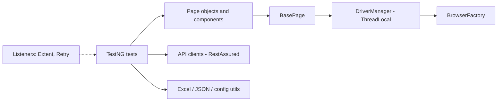
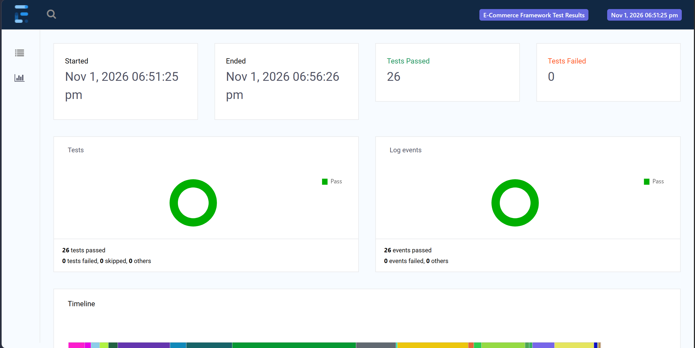
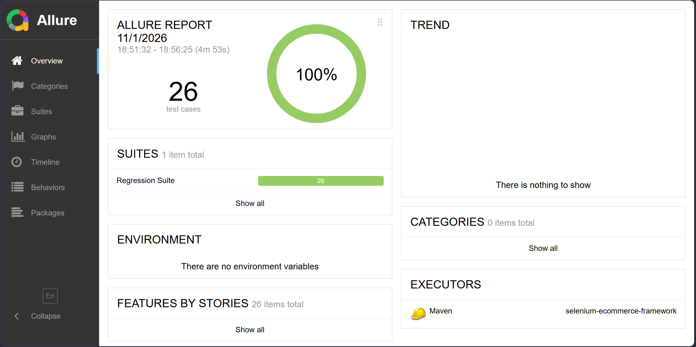
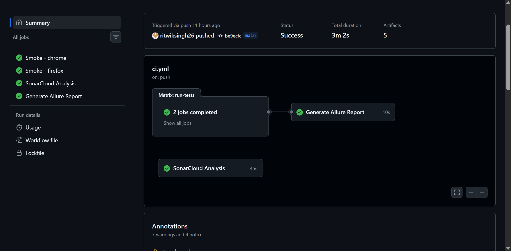
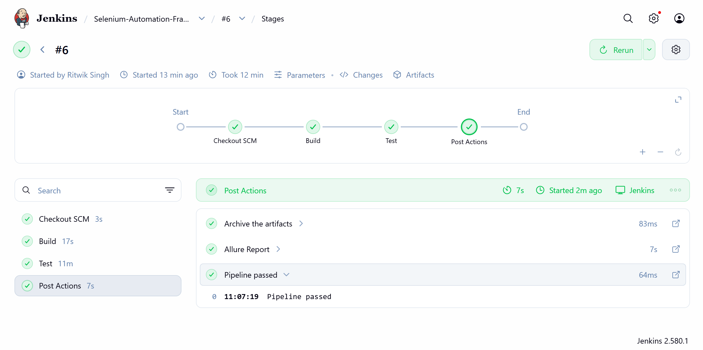
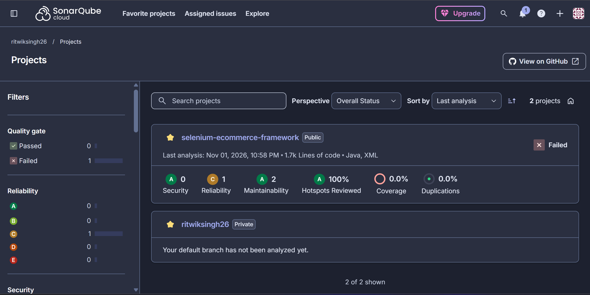

# Selenium E-commerce Automation Framework


[](https://sonarcloud.io/dashboard?id=ritwiksingh26_selenium-ecommerce-framework)

UI and API test automation framework in Java for [automationexercise.com](https://automationexercise.com),
an e-commerce practice site, covering registration, login, search, cart, checkout and more.

## Tech stack

| Area | Tools |
|---|---|
| Language / build | Java 21, Maven |
| UI automation | Selenium WebDriver 4, TestNG |
| API testing | RestAssured, JSON schema validation |
| Design | Page Object Model, Factory (browsers), ThreadLocal driver |
| Test data | Apache POI (Excel), Jackson (JSON), per-environment properties |
| Reporting | Extent Reports, Allure |
| Logging | Log4j2 |
| CI | GitHub Actions (Chrome + Firefox matrix), Jenkinsfile, SonarCloud |

## Architecture



## Project structure

```
src/main/java/com/sdet/
├── base/         BaseTest, DriverManager
├── pages/        page objects (Login, Register, Products, Cart, Checkout, ...)
├── components/   NavBar, Footer, Sidebar, CartModal
├── factory/      BrowserFactory
├── config/       ConfigReader (per-environment)
├── listeners/    TestListeners, RetryAnalyzer, RetryListener
├── utils/        ExcelUtil, JsonUtil, ScreenshotUtil, ExtentManager, TestGroups
└── api/          RestAssured clients and models
src/test/java/com/sdet/tests/   UI and API tests
src/test/resources/             config, suites, test data, schemas
```

## Test coverage

| Module | Test cases |
|---|---|
| Registration, Login | TC-01 to TC-06 |
| Search, Product details | TC-07 to TC-11 |
| Cart | TC-12 to TC-16 |
| Checkout | TC-17 to TC-20 |
| Navigation, Contact Us, Subscription | TC-21 to TC-26 |
| UI validation, end-to-end | TC-27 to TC-30 |
| API (restful-booker) | TC-API-01 to TC-API-08 |

26 automated tests in total. Checkout tests create their users through the site's REST API and delete them afterwards.

## Running the tests

```bash
mvn test -Psmoke                    # smoke suite
mvn test -Psanity                   # sanity suite
mvn test -Pregression               # full regression
mvn test -Papi                      # API tests
mvn test -Pregression,firefox       # another browser
mvn test -Pregression -Denv=staging # another environment
mvn test -Pregression -Dheadless=true
mvn allure:serve                    # open the Allure report after a run
```

## CI

- **GitHub Actions:** runs the smoke suite on Chrome and Firefox in parallel, uploads Allure,
  Extent, screenshot and log artifacts, and builds a combined Allure report.
- **SonarCloud:** static analysis of `main`.
- **Jenkinsfile:** parameterised pipeline (suite, browser, environment) with archived reports.

## Branching

Work happens on `feature/*` branches, merged into `dev` through pull requests that must pass CI,
then promoted to `main`. Both `dev` and `main` are protected.

## Reports

| Extent | Allure |
|---|---|
|  |  |

| GitHub Actions | Jenkins | SonarCloud |
|---|---|---|
|  |  |  |

## Known limitations

- Tests run against a public third-party site, which sometimes shows ad overlays or
  bot-verification pages to CI traffic. Retries and fallbacks reduce this, but occasional
  flaky runs happen, most often on Firefox.
- `docker/docker-compose.yml` defines a Selenium Grid and `DriverManager` supports it,
  but the Grid has not been executed in CI.
- The Contact Us form only enforces the email field, so TC-25 checks that.

## Next steps

API tests against automationexercise.com, using the API for test data setup and teardown.